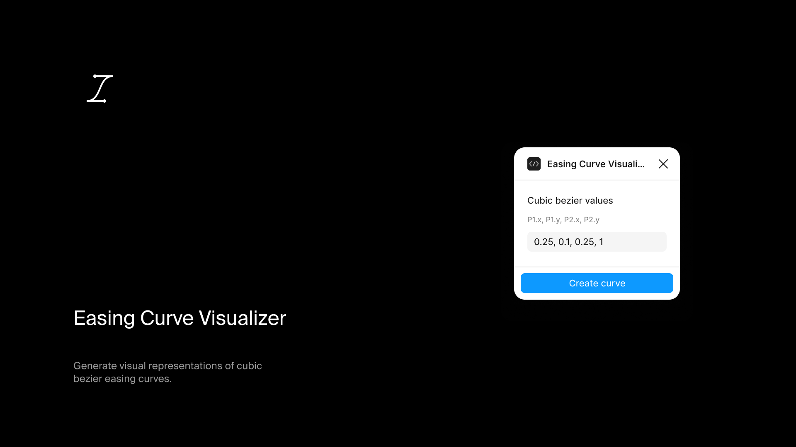

# Easing Curve Visualizer

Draw the curve and control points of any cubic-bezier easing function.

## Install

Get it from the [Figma Community](https://www.figma.com/community/plugin/1545751135317915826/easing-curve-visualizer)

## What it does

Creates a frame showing the control points and curve shape for any `cubic-bezier(x1, y1, x2, y2)` timing function. Useful for documenting animation specs or understanding easing behavior.

## Usage

1. Run the plugin
2. Enter the four cubic bezier values (x1, y1, x2, y2)
3. Click create

For each screen and what its controls do, see the [user guide](https://figma-plugins.notion.site/Easing-Curve-Visualizer-3ecf29c09c9d8176a31ad6e89de94308).

## Output

A 240×240px frame containing:
- Dashed bounding box
- Linear reference line
- Control point handles
- The bezier curve
- Start/end points and control point markers

## Development

```bash
npm install
npm run dev    # Watch mode
npm run build  # Production build
```
