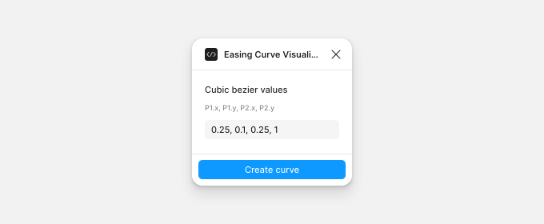
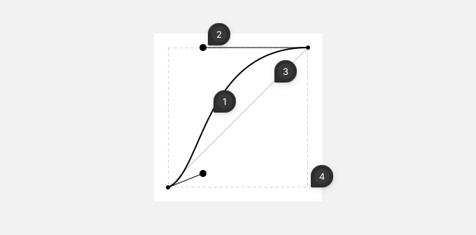

# Easing Curve Visualizer

Easing Curve Visualizer draws the curve of a CSS `cubic-bezier()` timing function, for your animation specs. You enter its four values, and the plugin places the curve on the canvas as a frame, with its control points.

## Create a curve

Enter the four values in the order of CSS `cubic-bezier()`, separated by commas: `P1.x, P1.y, P2.x, P2.y`. For the CSS `ease` curve, enter `0.25, 0.1, 0.25, 1`. The two x values, the first and the third, must be between 0 and 1, since they're points in time. The y values can be outside that range, for a curve that overshoots.

If a value isn't valid, the field says what to fix and the button stays disabled.

Click **Create curve**, or press Enter. The plugin places the frame in the middle of the view, selects it and closes. Press Ctrl/Cmd+Z to undo.

### The curve frame

The frame is 240 × 240 px, named after its values: `Easing: cubic-bezier(0.25, 0.1, 0.25, 1)`.

1. **The curve**: the easing from start (bottom left) to end (top right). Time runs from left to right, and progress from bottom to top.
2. **The control points**: P1, joined to the start, and P2, joined to the end. Each one pulls the curve toward it.
3. **The linear line**: a reference for a linear easing. Where the curve is above the line, the animation is further along than a linear one.
4. **The dashed box**: the range from 0 to 1 on both axes.
